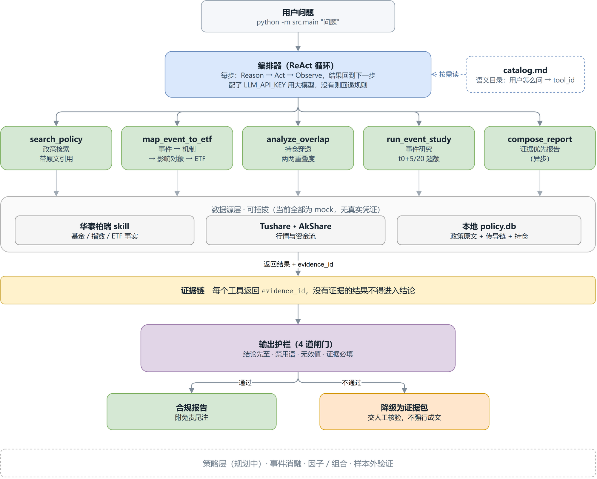

# ETF 政策研究 Agent

[](https://github.com/ChinaLyn/etf-research-agent/actions/workflows/tests.yml)

一个**面向 ETF 政策研究的垂直 AI Agent**：把「找政策 → 映射到 ETF → 看持仓 → 回测 → 出报告」这条研究闭环，
拆成五个可被编排器调用的研究工具，每个工具的结果都带 `evidence_id`，最终回答必须过输出护栏。

> 本项目为个人作品，用于展示「多数据源 + 多工具 + 证据链约束 + 输出护栏」的 agent 架构。
> 当前示例实现全部为 **mock 占位**，无任何真实密钥与私有数据。

## 架构



问题进来后，编排器按 `catalog.md` 选工具，工具向可插拔数据源取数，每条结果都带 `evidence_id`；
合稿后必须过输出护栏，不过关就降级为证据包，而不是照发。

> 可编辑源文件：[`docs/architecture.drawio`](docs/architecture.drawio)

## 五个工具

| tool_id | 作用 | 契约 |
| --- | --- | --- |
| `search_policy` | 政策检索，带原文引用 | `tools/search_policy.md` |
| `map_event_to_etf` | 事件 → 机制 → 影响对象 → 真实 ETF | `tools/map_event_to_etf.md` |
| `analyze_overlap` | 持仓穿透与两两重叠度 | `tools/analyze_overlap.md` |
| `run_event_study` | 事件研究（t0+5/20 超额） | `tools/run_event_study.md` |
| `compose_report` | 证据优先报告（异步） | `tools/compose_report.md` |

## 快速开始（零依赖、零凭证）

```bash
# 1) 直接看一个工具
python src/tools.py search_policy '{"query":"农机补贴","top_k":3}'

# 2) 跑一遍完整链路（问题 → 选工具 → 取证据 → 过护栏）
python -m src.main "农机补贴对持仓的影响"

# 3) 看每一步的决策和观察（ReAct 的 trace）
python -m src.main --trace "农机补贴对持仓的影响"

# 4) 单元测试
python -m pytest -q tests
```

## 大模型推理（可选）

编排器默认用规则推进。配置了模型之后，ReAct 里的 Reason 一步交给大模型：

```bash
export LLM_BASE_URL=https://api.deepseek.com    # 任意 OpenAI 兼容端点
export LLM_API_KEY=sk-...
export LLM_MODEL=deepseek-chat

python -m src.main --trace "农机补贴对持仓的影响"
```

每一轮把「问题 + 已执行步骤的观察结果」一起交给模型，模型只回一个 JSON：

```json
{"thought": "政策已拿到，但还不知道落到哪些 ETF", "action": "map_event_to_etf", "args": {"event_id": "ev_001"}}
```

解析失败、超时或返回了不存在的工具，就自动回退到规则，链路不会断。
没有 Key 时整条链路照样能跑，这也是 CI 里跑的那条路径。

关键不在「用了哪个模型」，而在**观察有没有回到下一轮的决策里**：
`run_steps` 每步都把结果追加进 `history`，下一次 `decide` 能看到它。

## 接入真实数据源

所有工具当前返回 mock。要接真实数据，把 `src/tools.py` 里的实现替换为对数据源的调用：

1. 复制 `config.example.json` 为 `config.json`，填数据源地址与凭证环境变量名（不填真实 Key）。
2. 凭证放环境变量或本地凭据文件，绝不入库（见 `.gitignore`）。
3. 数据源可以是：华泰柏瑞 ETF skill（基金/指数/ETF 事实数据）、Tushare/AkShare（行情）、
   你自己的政策库（政策原文 + 传导链 + 持仓明细）。

## 设计要点

- **证据必填**：每个工具返回带 `evidence_id`，无证据的结果会被护栏拒绝进入结论。
- **样本不足不下结论**：事件研究同类样本 <3 条时如实报告「样本不足」。
- **不补造机制**：抽不出传导链时记「直接作用」。
- **不过闸门降级**：生成不合规时降级为证据包，不强行成文。
- **按需读文档**：`catalog.md` 选工具 → `tools/<id>.md` 拿参数口径 → 调用。
- **观察回流**：每一步的结果都进 `history`，下一步的决策基于它，而不是重复同一个调用。

## License

MIT
